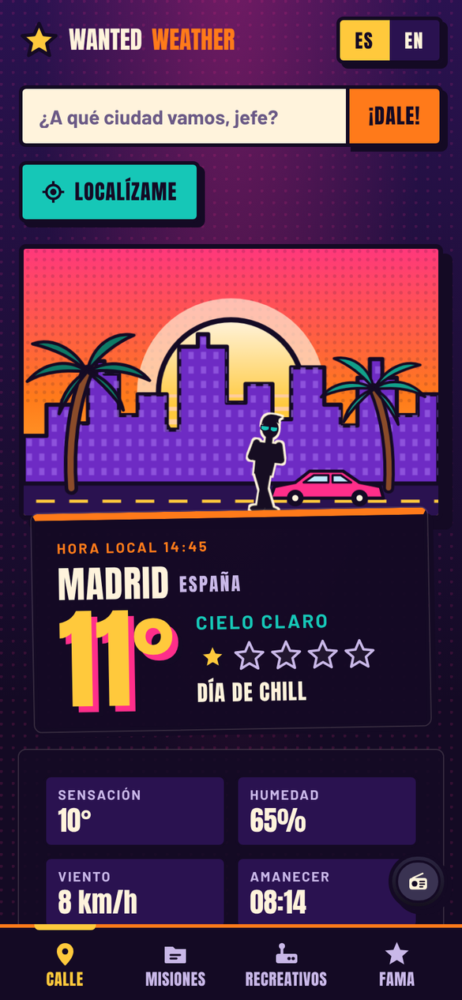
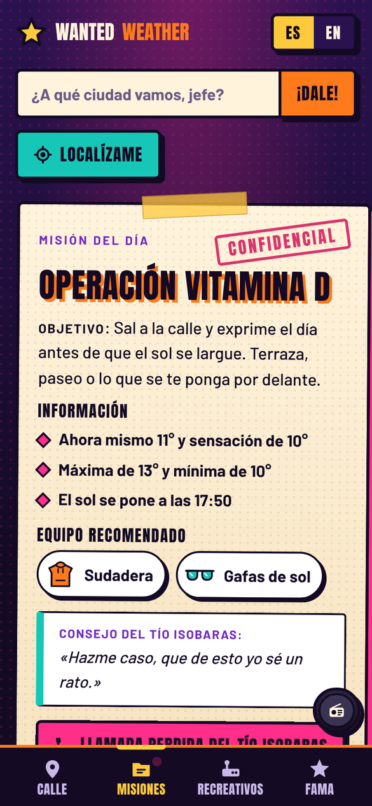
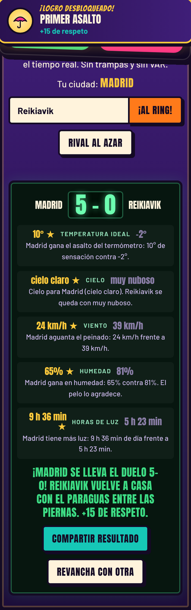
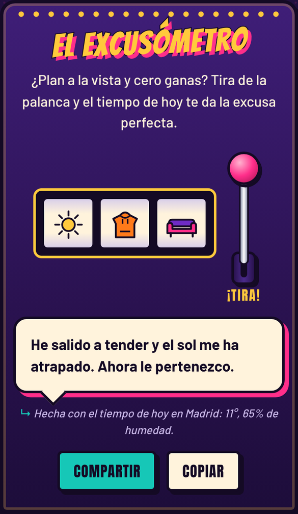
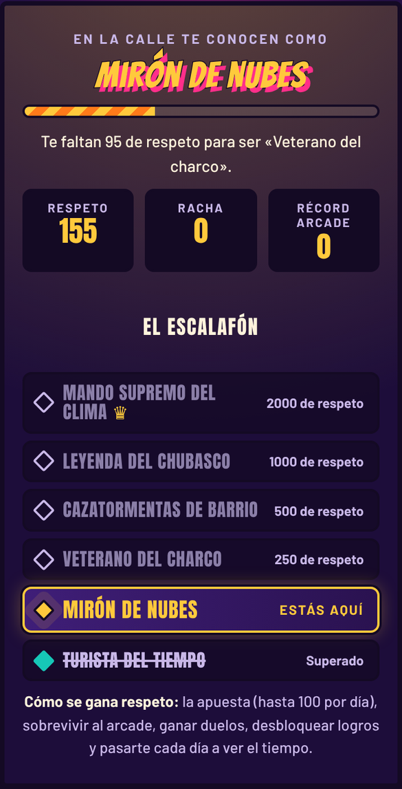
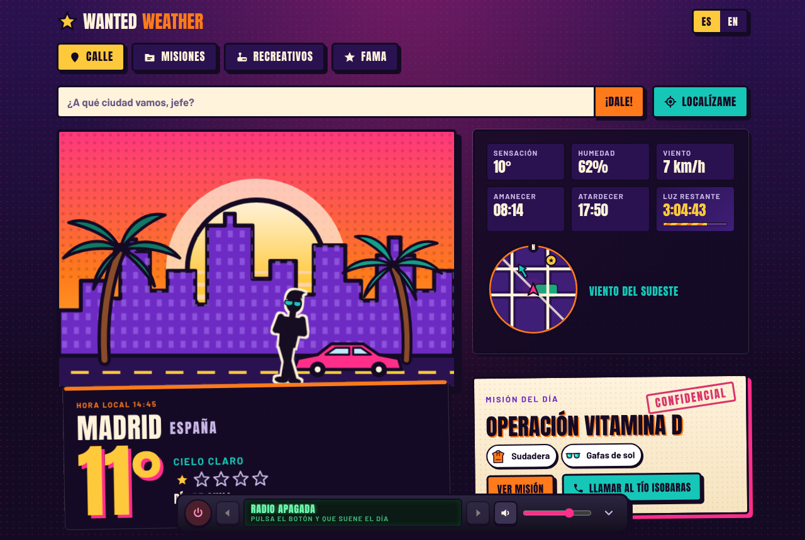

# Wanted Weather

A weather app that plays like an open-world game. Your city is the map and today's weather is the mission. You get real forecasts, wanted-level stars, extreme-weather alerts, daily missions, a car radio, arcade mini-games, achievements and a shareable movie poster of the day. It opens in Spanish on phones set to Spanish and in English on any other language, with an ES/EN switch that is remembered. Built with AI for the AI Maker programme (Project 2).

**Live:** https://jplataes.github.io/wanted-weather/

<p>
  
  
  
</p>

<p>
  
  
  
</p>



## Features
- **HUD.** It shows the city, a big temperature, the condition, feels like, humidity, wind and sunrise/sunset. It also has an illustrated minimap with the real wind direction and a 1–5 star "wanted level" that explains why the day is rough.
- **Extreme-weather alerts.** Rain, heat, cold, wind and storm each get a full-screen game banner with its own effect.
- **Eight illustrated scenes.** Clear, clouds, rain, storm, snow, fog, wind and night are all drawn in SVG, each with its own characters. A "living screen" layer adds rain on the glass, frost, haze and lightning.
- **Missions.** The mission of the day comes with an objective, real intel and recommended gear. The next days appear as "upcoming missions".
- **Uncle Isobar.** A fictional contact phones you with the mission, dares and results. The voice uses Speech Synthesis and only plays if you answer.
- **Car radio.** Four fictional stations play music generated live with the Web Audio API. Hosts read real forecast lines, made-up ads, traffic reports and dedications. The radio is off by default, with volume and mute, and the station follows the weather.
- **Arcade.**
  - **Excuse-o-matic:** a lever-pulled slot machine that builds an excuse from today's weather.
  - **City Duel:** five rounds of real weather against any city, with a shareable result card.
  - **The Bet:** guess tomorrow's high; it is checked the next day.
  - **Dodge the Downpour:** a canvas game where the real weather decides what falls and the real wind pushes it.
- **Fame.**
  - A movie poster of the day, in poster or stories format, downloadable as a PNG or shareable. Each weather type maps to its own film genre.
  - 23 achievements and a nickname ladder that shows where you are and what's left to reach the top.
- **Errors in the game's style.** City not found, invalid key, quota reached, no connection and service down are all covered. The app never shows a broken screen.
- **Remembers you.** It keeps the last result for an instant next visit, plus your language, respect, streaks and achievements, all saved on the device.

## Quality
- Lighthouse (production build):
  - mobile: performance 96, accessibility 100, best practices 100, SEO 100;
  - desktop: 100 in all four.
- axe: 0 accessibility issues in every zone. Keyboard navigation with visible focus, `aria-live` for results and errors, and `prefers-reduced-motion` respected.
- W3C HTML validator: 0 errors.
- Content Security Policy: the page can only talk to its own site and the weather proxy.
- Tests:
  - 63 logic tests (`npm test`);
  - 26 browser tests on phone and desktop (`npm run test:e2e`), run in Chromium against the real production build with saved real API responses.
  - Both run on every pull request.

## Run it locally
```bash
npm install
cp .env.example .env   # then put your OpenWeatherMap key in VITE_OPENWEATHER_API_KEY
npm run dev
```
Tests:
```bash
npm test
npx playwright install chromium   # once
npm run test:e2e
```

### Test helpers
Add these to the URL:
- `?alerta=storm` (or `rain`, `heat`, `cold`, `wind`) to see an alert;
- `?escena=snow` (or `sun`, `clouds`, `rain`, `storm`, `fog`, `wind`, `night`) to force a scene;
- `?efecto=rain` (or `storm`, `snow`, `fog`, `wind`, `heat`, `cold`, `none`) to force the screen effect;
- `?llamada=1` to get the phone call again.

## How the API key is protected
The published app never contains the key. It calls a tiny Cloudflare Worker (`worker/`), which adds the key on the server. The Worker only answers GET requests from the app's own website and caches answers for 10 minutes. The key is stored as a secret in Cloudflare and in GitHub Actions, never in the code. The deploy checks that no key ended up in the published files before publishing.

## Structure
- `src/api.js` – requests to the weather service and error handling
- `src/dom.js`, `src/missions-view.js` – everything drawn on the page
- `src/main.js` – starts the app and connects actions, data and drawing
- `src/weather.js` – game logic: wanted level, scenes, formatting
- `src/forecast.js`, `src/missions.js` – daily forecast summary, mission of the day and gear
- `src/call.js`, `src/fx.js` – the phone call and the living-screen effects
- `src/radio.js`, `src/radio-lines.js` – the car radio and its hosts
- `src/excuses.js`, `src/excusometer.js` – the Excuse-o-matic
- `src/poster.js`, `src/poster-copy.js`, `src/fama.js` – the movie poster and the Fame zone
- `src/duel.js`, `src/duel-ui.js` – the City Duel
- `src/bet.js`, `src/bet-ui.js`, `src/progress.js` – The Bet, respect and streaks
- `src/dodge.js` – Dodge the Downpour
- `src/achievements.js`, `src/achievements-ui.js` – achievements, nickname ladder and trophy cabinet
- `src/i18n.js`, `src/copy.js` – texts in Spanish and English
- `src/scenes.js`, `src/minimap.js`, `src/icons.js` – illustrations drawn in SVG
- `src/geo.js`, `src/storage.js` – location and saved data
- `worker/` – the Cloudflare Worker proxy
- `tests/` – logic tests and browser tests (`tests/e2e/`)
- `muestra/` – the visual style guide (phase 0)
- `docs/` – screenshots, the mid-project checkpoint and the project report (`MEMORIA.md`, in Spanish)

## Technologies
- Vite and plain JavaScript (ES modules), with SVG and CSS for every illustration.
- Browser APIs: Web Audio, Speech Synthesis, Geolocation and Canvas.
- OpenWeatherMap API, Cloudflare Workers, GitHub Pages and GitHub Actions.
- Playwright for the browser tests.
- Fonts: Anton, Bangers and Barlow (SIL Open Font License). No frameworks or heavy libraries.

## Built with AI
The project owner directed the work and made every product decision. Claude Code (Anthropic) wrote all the code. The work went phase by phase, with one branch and one reviewed pull request per phase. See [PLAN.md](PLAN.md) for the phases and decisions, and [docs/MEMORIA.md](docs/MEMORIA.md) for how it was built.

## Credits
Weather data: [OpenWeatherMap](https://openweathermap.org/). Made by [Javier Plata](https://www.linkedin.com/in/javierplata/) · [GitHub](https://github.com/jplataes). Built with AI.
