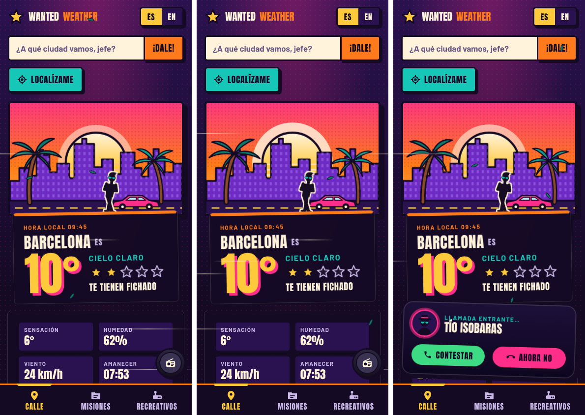

# Checkpoint de mitad de camino (fase 4)

Revisión de la app publicada en https://jplataes.github.io/wanted-weather/ el 27/11/2026, después de las fases 0 a 3, desde dos miradas:

1. un **desarrollador experto**, con herramientas objetivas (Lighthouse, axe y el validador del W3C) y una lectura del código;
2. un **usuario de a pie**, que solo quiere saber qué tiempo hace y pasárselo bien, en su primera visita desde el móvil.

Al final hay una propuesta de qué arreglar ahora y qué dejar. **Decide el propietario.**

---

## Resumen en una frase

La base es sólida, rápida y accesible. Lo que hay que pulir es **la experiencia de la primera visita**: demasiadas cosas compiten por la atención en los primeros segundos y algunas no se explican solas.

## Las notas

| Prueba | Móvil | Ordenador |
|---|---|---|
| Lighthouse · Rendimiento | **91** | **81** |
| Lighthouse · Accesibilidad | **100** | **100** |
| Lighthouse · Buenas prácticas | **100** | **100** |
| Lighthouse · SEO | **100** | **100** |
| Primer contenido visible | 0,9 s | 0,3 s |
| Contenido principal visible | 1,6 s | 0,6 s |
| Saltos de diseño (CLS, mejor por debajo de 0,1) | 0,10 | **0,40** ⚠️ |
| axe (accesibilidad, todas las zonas) | 2 avisos | — |
| Validador W3C | 2 errores, 3 avisos | — |
| Pruebas automáticas | 34 de 34 | — |
| Errores en la consola | 0 | 0 |

---

## 1. Mirada del desarrollador experto

### Lo que está bien
- **Seguridad de la key:** está solo en Cloudflare; ni la web ni las peticiones ni el historial de Git la contienen. El intermediario rechaza webs ajenas (403), métodos que no sean GET (405) y parámetros raros, y guarda respuestas 10 minutos para cuidar el cupo.
- **Errores controlados:** cada fallo de red tiene su pantalla. Si fallan los extras (previsión o nombre local), el resto sigue funcionando.
- **Módulos con una responsabilidad clara** (red, pantalla, lógica del juego, textos, radio, misiones…) y lógica del juego probada con 34 pruebas.
- **Ligera:** unos 38 KB de JavaScript y 10 KB de estilos comprimidos, sin librerías pesadas. Las ilustraciones están dibujadas en código y la música se genera en el navegador, sin archivos de audio.
- **Respeta "reducir movimiento"** y el sonido nunca arranca solo.

### Lo que hay que arreglar
| # | Problema | Por qué importa | Esfuerzo |
|---|---|---|---|
| D1 | **Salto de diseño al cargar en ordenador** (CLS 0,40). La zona principal aparece de golpe y empuja el pie de página. | Es lo que baja la nota de rendimiento a 81 y lo que PageSpeed va a señalar en la entrega. | Pequeño: reservar el hueco mientras carga |
| D2 | **2 errores del validador W3C:** el icono de la pestaña tiene espacios mal codificados y un filtro SVG (el calor de la alerta) no tiene uno de sus datos obligatorios. | El curso pide validar con el W3C. | Muy pequeño |
| D3 | **Sin título principal (h1) en Misiones y Recreativos.** El h1 es el nombre de la ciudad y solo existe en Calle. | Los lectores de pantalla se orientan por el h1. | Pequeño: el logo pasa a ser el h1 |
| D4 | **La lista de próximos días no se puede desplazar con el teclado.** | Accesibilidad (axe la marca como "grave"). | Muy pequeño |
| D5 | **Las pruebas en navegador** (las que he ido pasando en cada fase) viven fuera del repositorio. | Si alguien cambia algo, nadie lo comprobaría automáticamente. | Medio: añadirlas al proyecto y a GitHub |

### Mejoras recomendables, no urgentes
- **Rendimiento en móviles modestos:** el bloqueo del hilo principal es de 290 ms en móvil. Lo causan los filtros SVG de los personajes y muchas animaciones a la vez. Hoy está bien; vigilarlo cuando lleguen más escenas.
- **Política de seguridad de contenido (CSP):** una línea que le dice al navegador a qué servidores puede hablar la página. Protección extra gratuita.
- **`dom.js` está creciendo** (313 líneas). Conviene separar la parte de misiones antes de añadir el póster.
- **Aviso sin JavaScript:** un mensaje del tipo "esta app necesita JavaScript" para el caso raro de que esté desactivado.

---

## 2. Mirada del usuario de a pie

Primera visita desde un móvil, desde Barcelona (imagen: `docs/checkpoint-primera-visita.png`, a los 1, 3 y 6 segundos).

### Lo que funciona
- **En menos de un segundo** ya ve ciudad, temperatura gigante, cielo y estrellas, sin bajar. La pregunta "¿qué tiempo hace?" queda respondida en 3 segundos. ✅
- La escena con el tipo de las gafas y el coche **arranca una sonrisa** y se entiende que es un juego.
- Las pestañas de abajo son las de cualquier app: se entienden sin explicación.

### Lo que le despista
| # | Problema | Lo que piensa el usuario | Propuesta |
|---|---|---|---|
| U1 | **La llamada tapa los datos a los 3,5 segundos.** Aparece encima de sensación, humedad y viento justo cuando los está leyendo. | "¿Qué es esto? ¿Una llamada? ¿Me están vendiendo algo?" | Que la llamada entre como una **notificación pequeña arriba**, estilo móvil, sin tapar el HUD. Y que espere a que el usuario haya mirado el tiempo: unos 8 segundos, o al bajar. |
| U2 | **Las rayas del viento cruzan los textos.** Con viento, las líneas pasan por encima de "BARCELONA" y de la temperatura. | "Se ve roto, ¿no?" | Que el viento y la niebla pasen **por detrás** de los paneles. Las gotas de lluvia sí pueden seguir delante, que es el efecto cristal. |
| U3 | **No sabe por qué hay 2 estrellas** con cielo despejado y 10°. Era por las rachas de viento: 43 km/h, según los datos de ese momento. | "¿2 estrellas de qué?" | Al tocar las estrellas, una línea explica el motivo: "Rachas de 43 km/h". Gamberro e informativo a la vez. |
| U4 | **El "ES" junto a la ciudad** parece el idioma, no el país. | "¿ES de español?" | Mostrar el país completo ("España") o quitarlo. |
| U5 | **Buscar "Santiago" lleva a Costa Rica,** no a Chile ni a Santiago de Compostela. Con Valencia, Córdoba o León acierta España, pero los nombres repetidos fallan. | "Esta app no funciona." | Si hay varias ciudades con ese nombre, mostrar **una lista corta para elegir** ("Santiago, Chile · Santiago de Compostela, España · Santiago, Costa Rica…"). |
| U6 | **La burbuja de la radio** tapa una esquina de los datos en el móvil. | Leve; es pequeña. | Moverla un poco más arriba o hacerla más pequeña. |

---

## 3. Propuesta de qué arreglar ahora (fase 4b)

Para hacer ahora, antes del póster (lo que más impacto tiene por menos esfuerzo):

1. **U1** La llamada como notificación pequeña que no tapa el HUD.
2. **U2** El viento y la niebla por detrás de los textos.
3. **U5** Elegir entre ciudades con el mismo nombre.
4. **U3** Explicar las estrellas al tocarlas.
5. **U4** País completo junto a la ciudad.
6. **D1 + D2 + D3 + D4** Salto de diseño, errores del W3C, h1 y teclado en la lista. Son técnicos y rápidos, y suben las notas que pide el curso.

Para dejar a la fase 9 de pulido: **D5** (pruebas en navegador dentro del proyecto), CSP, separar `dom.js`, aviso sin JavaScript y **U6** (posición de la burbuja).

---

## 4. Resultado tras los arreglos (fase 4b)

El propietario aprobó toda la propuesta. Medido después de los arreglos, en la versión de producción:

| Prueba | Móvil | Ordenador |
|---|---|---|
| Lighthouse · Rendimiento | **99** (antes 91) | **100** (antes 81) |
| Lighthouse · Accesibilidad / Buenas prácticas / SEO | 100 / 100 / 100 | 100 / 100 / 100 |
| Saltos de diseño (CLS) | 0,08 (antes 0,10) | 0,04 (antes 0,40) |
| axe, todas las zonas | 0 avisos | — |
| Validador W3C | 0 errores | — |

Las cinco molestias del usuario de a pie (U1 a U5) están resueltas. U6 (la burbuja de la radio) queda para la fase 9.
